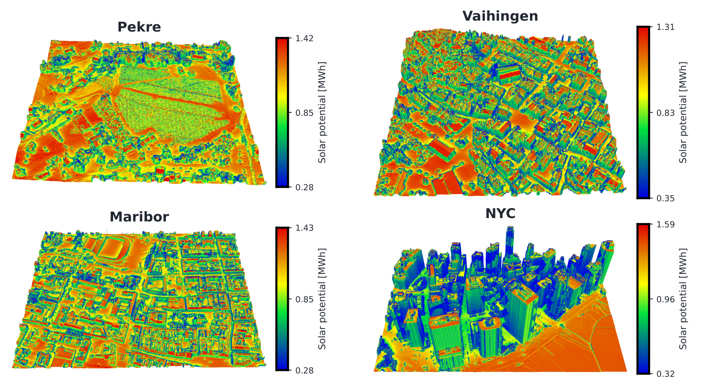

# SolarGPU

**Version: 1.0**



*Annual solar potential estimated with SolarGPU on four LiDAR-derived DSMs (Pekre, Vaihingen, Maribor, New York City). Figure 13 of Lukač & Žalik, Remote Sensing 18(17), 3044, 2026 ([doi:10.3390/rs18173044](https://doi.org/10.3390/rs18173044)), CC BY 4.0. The test DSM in `test_data/` is the Pekre scene.*

## Description

GPU-accelerated annual solar irradiance estimation pipeline over a digital surface model (DSM), with shadowing, diffuse, direct and reflective irradiance. This implementation supports a compact "ba-RLE" compressed representation for the viewshed neighbor lists that the reflection pass streams through each time step.

Given a GeoTIFF of DSM heightmap, the pipeline:

1. Voxelizes it: one "top" voxel per pixel, plus stacked "wall" voxels.
2. On the GPU, out-of-core: traces a discretized hemisphere of directions  from every voxel to build per-voxel list of viewshed-neighbors.
3. For every hour of a full year: solar irradiance computation.

Steps 2-3 run **twice**, back-to-back, as two separate GPU pipeline
instances that differ only in how a voxel's neighbor list is stored:

- **`uncompressed_gpu_irradiance`**: a CSR-compact array (flat neighbor
  ids + a per-voxel offset table).
- **`compressed_gpu_irradiance`**: the same neighbor lists, ba-RLE
  compressed and decoded on the fly inside the reflection GPU kernel.

## Building

Requires a CUDA-capable GPU + toolkit (nvcc), CMake >= 3.18, and libtiff.

```bash
mkdir build && cd build
cmake -DCMAKE_CUDA_ARCHITECTURES=86 ..   # match your GPU's compute capability
cmake --build . -j
```

## Running

```bash
./SolarGPU <dsm.tiff> <lon> <lat> <tzone> <direct.txt> <diffuse.txt>
```

- `[dsm.tiff]`: DSM's heightmap (float32 GeoTIFF)
- `[lon]`: longitude
- `[lat]`: latitude
- `[tzone]`: timezone, given as the UTC offset in hours
- `[direct.txt]`: Hourly TMY time-serises of horizontal direct irradiance
- `[diffuse.txt]`: Hourly TMY time-serises of horizontal diffuse irradiance

## Outputs

- `<file>_solar_potential.tiff`: annual irradiance raster
- `<file>_voxels.bin`: per-voxel (grid_x, grid_y, z, annual_irradiance)
  point dump

## Citation

This implementation is supplementary material for the paper *GPU-Based Solar Irradiance Estimation over Digital Surface Models Using Structurally Lossless Viewshed Compression* by Niko Lukač and Borut Žalik, University of Maribor.

If you use this software in your research, please cite the following papers:

```bibtex
@article{lukac2026viewshed,
  author  = {Luka{\v{c}}, Niko and {\v{Z}}alik, Borut},
  title   = {{GPU}-Based Solar Irradiance Estimation over Digital Surface Models Using Structurally Lossless Viewshed Compression},
  journal = {Remote Sensing},
  volume  = {18},
  number  = {17},
  pages   = {3044},
  year    = {2026},
  doi     = {10.3390/rs18173044}
}

@article{lukac2024diffuse,
  author  = {Luka{\v{c}}, Niko and Mongus, Domen and {\v{Z}}alik, Borut and {\v{S}}tumberger, Gorazd and Bizjak, Marko},
  title   = {Novel {GPU}-accelerated high-resolution solar potential estimation in urban areas by using a modified diffuse irradiance model},
  journal = {Applied Energy},
  volume  = {353},
  pages   = {122129},
  year    = {2024},
  doi     = {10.1016/j.apenergy.2023.122129}
}

@article{lukac2013rating,
  author  = {Luka{\v{c}}, Niko and {\v{Z}}laus, Danijel and Seme, Sebastijan and {\v{Z}}alik, Borut and {\v{S}}tumberger, Gorazd},
  title   = {Rating of roofs' surfaces regarding their solar potential and suitability for {PV} systems, based on {LiDAR} data},
  journal = {Applied Energy},
  volume  = {102},
  pages   = {803--812},
  year    = {2013},
  doi     = {10.1016/j.apenergy.2012.08.042}
}
```
